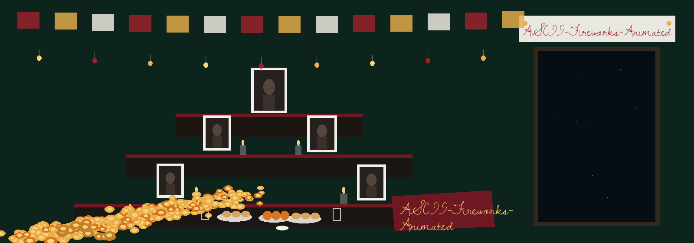

# ASCII-Fireworks-Animated

Two small firework animations from 2023, sharing a repo:

- `minimal-fireworks.py` is the ASCII one: it prints rows of asterisks in
  random colors and lengths in the terminal, forever, until Ctrl+C. It
  needs nothing but Python 3.

  ```
  python3 minimal-fireworks.py
  ```

- `large-fireworks.py` draws filled circles in a pygame window, with the
  stick figure from `stick_figure.png` following each burst. It is not
  ASCII; it is in this repo because it is the same idea taken further.
  It needs pygame. The image is loaded from the script's own folder, so
  the script can be launched from any working directory:

  ```
  pip install pygame
  python3 large-fireworks.py
  ```




> Ofrenda label, taped before a photograph: two scripts, one idea, 2023. The visit below moves tier by tier.
